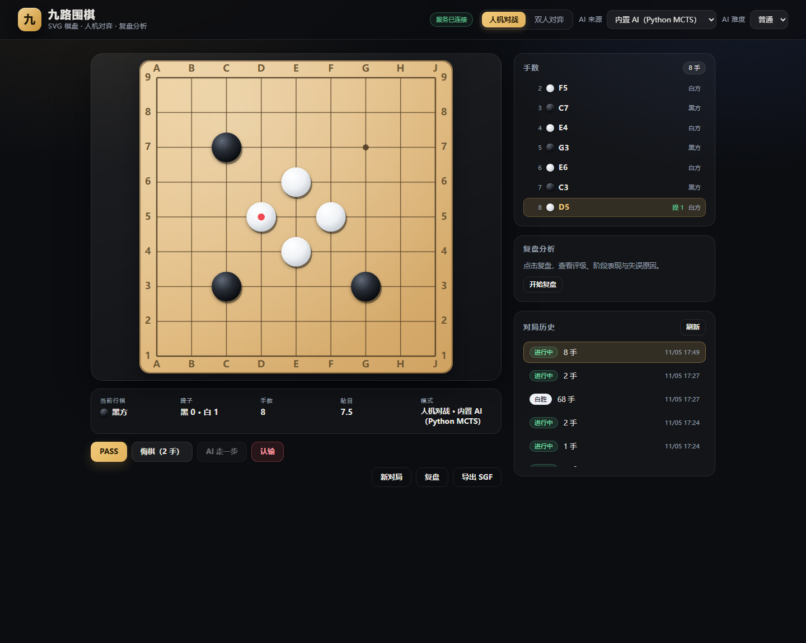
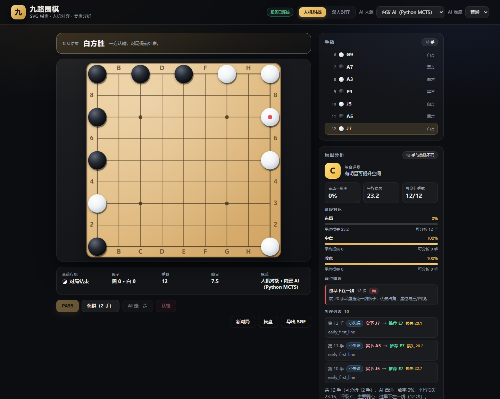

# go9-agent · 九路围棋

一个可玩、可复盘、可持久化的 9 路围棋 Web 应用。后端使用 Express + Prisma(SQLite)，
前端使用 React + Vite；内置 AI 由**本地 Python 源码 `server/ai/go_ai.py`** 提供
（MCTS + 静态先验 + 收官停一手），并支持**接入自己的 AI**（OpenAI 兼容接口或 KataGo）
进行对弈与赛后缺点分析。

## 功能

- **规则引擎**：提子、自杀禁手、打劫（位置超级劫）、连续两次 PASS 数子终局、认输、悔棋（可跨终局）
- **可插拔 AI（Agent）**：
  - **内置 AI（Python MCTS）**：默认由 `server/ai/go_ai.py` 出招——静态启发式先验 + 蒙特卡洛树搜索 +
    收官自动停一手；三档难度 easy / medium / hard 约 0.3s / 1.3s / 2.6s 每手（含 Python 进程启动）。
    Python 不可用或调用失败时自动回退 JS 内置 MCTS，保证永远能出招。
  - **接入自己的 AI**：任何 OpenAI 兼容的 HTTP 服务（OpenAI / DeepSeek / Ollama / 自建 Python 服务等），或本地 KataGo（GTP）
  - 外部 AI 未配置/超时/返回非法着点 → 自动回退内置 AI，对局不中断
- **人机 / 双人对弈**：人机模式玩家执黑，落子后所选 AI 自动应手
- **赛后复盘分析**：逐手评分 → 平均损失 → 失误分级（不精确/失误/恶手）→ 阶段统计（布局/中盘/收官）→ 弱点聚合与改进建议 + 评级（A/B/C/D）
- **对局持久化**：SQLite 保存棋谱与所用 AI（`aiProvider`），刷新/重启后可继续最近一局
- **SGF 导出**：标准 SGF(FF[4])，含贴目、结果、日期
- **现代化界面**：SVG 棋盘（星位/坐标/最后一手/悬停预落子）、AI 来源选择、响应式布局、终局横幅、错误与回退提示

## 技术栈

| 层 | 技术 |
| --- | --- |
| 前端 | React 19、Vite 8、原生 CSS、SVG 棋盘 |
| 后端 | Node.js 22+、Express 5、Prisma 7 + better-sqlite3 |
| 内置 AI | Python 3（`server/ai/go_ai.py`，MCTS），Node 通过子进程调用；失败回退 JS MCTS |
| 外部 AI | OpenAI 兼容 HTTP / KataGo GTP，统一 provider 注册表 + 自动回退 |
| 测试 | Node 内置 `node:test`（后端）、oxlint（前端） |

## 目录结构

```
go9-agent/
├── client/                 # React + Vite 前端
│   ├── src/
│   │   ├── api.js          # /api 客户端封装
│   │   ├── App.jsx         # 页面编排（含 AI 来源选择/回退提示）
│   │   └── components/     # GoBoard / ModeBar / AnalysisPanel / MoveList ...
│   └── vite.config.js      # 开发代理 /api -> :3001
├── server/                 # Express + Prisma 后端
│   ├── src/
│   │   ├── app.js          # createApp()，路由与校验
│   │   ├── index.js        # 启动入口
│   │   ├── db.js           # Prisma 客户端（绝对路径 + 降级）
│   │   ├── gameStore.js    # 内存对局 + 持久化/回放 + AI 调用
│   │   ├── sgf.js          # SGF 序列化
│   │   ├── games/go9.js    # 围棋规则引擎
│   │   ├── agents/         # AI provider：registry / 内置(Python+JS) / HTTP / KataGo
│   │   └── analysis/       # 复盘分析（评分/分级/弱点）
│   ├── ai/go_ai.py         # 内置 AI 源码（Python MCTS，可独立修改/测试）
│   ├── scripts/            # ai:check / 基准测试等辅助脚本
│   ├── prisma/             # schema 与迁移
│   └── tests/              # node:test 测试
├── docs/                   # API / 架构 / AI 接入文档
├── scripts/                # dev / build 辅助脚本
└── package.json            # 根级一键脚本
```

## 快速开始

前置条件：Node.js ≥ 22（测试使用了 `node --test --test-isolation=none`），npm；
内置 AI 需要 Python 3（`server/ai/go_ai.py`，无需第三方包；没有 Python 时自动回退 JS 内置 AI）。

```bash
# 1. 安装依赖
cd server && npm install
cd ../client && npm install

# 2. 生成 Prisma 客户端并初始化数据库（首次）
cd ../server
npx prisma generate
npx prisma migrate deploy        # 或者开发时用：npx prisma migrate dev

# 3. 回到根目录，一键启动前后端
cd ..
npm run dev
```

- 前端：http://localhost:5173（`/api` 由 Vite 代理到后端）
- 后端：http://localhost:3001（`GET /api/health` 可自检，含数据库状态）

> 也可以分别启动：`npm run dev:server` / `npm run dev:client`，或 `cd server && npm run dev`。

### Windows 一键启动

交付目录根下的 `启动围棋.cmd` 会自动检查依赖、生成 Prisma 客户端、启动前后端并打开浏览器：

```text
双击 启动围棋.cmd
```

首次运行如果没有 `node_modules`，脚本会先执行 `npm install`（需要网络）。

## 界面

| 对局 | 赛后自动复盘 |
| --- | --- |
|  |  |

## 环境变量

`server/.env`（参考 `server/.env.example`）：

| 变量 | 默认值 | 说明 |
| --- | --- | --- |
| `PORT` | `3001` | 后端监听端口 |
| `DATABASE_URL` | `file:./dev.db` | SQLite 文件，相对 server 目录解析；支持绝对路径 |
| `DISABLE_DB` | - | 设为 `1` 时纯内存运行（测试/演示用） |
| `CORS_ORIGIN` | `*` | 允许的前端来源（开发默认放开） |
| `AI_PROVIDER_DEFAULT` | `heuristic` | 默认 AI：`heuristic` / `http` / `katago` |
| `LOCAL_AI_PYTHON` | 自动探测 | Python 解释器（Windows 默认 `python`/`py`，其它 `python3`/`python`） |
| `LOCAL_AI_SCRIPT` | `server/ai/go_ai.py` | 内置 Python AI 脚本路径 |
| `LOCAL_AI_TIMEOUT_MS` | `8000` | Python AI 单次调用超时（超时自动回退 JS 内置 AI） |
| `LOCAL_AI_SEED` | - | 可选，固定 Python AI 随机种子（便于复现） |
| `AI_HTTP_BASE_URL` | - | OpenAI 兼容服务地址，如 `https://api.deepseek.com/v1` |
| `AI_HTTP_MODEL` | - | 模型名，如 `deepseek-chat` |
| `AI_HTTP_API_KEY` | - | 外部 API Key（本地 Ollama 可留空） |
| `AI_HTTP_TIMEOUT_MS` | `15000` | 外部 AI 超时（超时自动回退内置 AI） |
| `KATAGO_CMD` / `KATAGO_ARGS` | - | KataGo 可执行文件与 GTP 参数 |

前端可通过 `VITE_API_BASE` 指定 API 前缀（默认 `/api`，走 Vite 代理）。

### 接入自己的 AI

内置 AI 之外，可任选一种方式接入（详见 [docs/AGENT-INTEGRATION.md](docs/AGENT-INTEGRATION.md)）：

```ini
# 方式一：任意 OpenAI 兼容 API（推荐；服务可用任何语言实现）
AI_PROVIDER_DEFAULT=http
AI_HTTP_BASE_URL=https://api.deepseek.com/v1
AI_HTTP_MODEL=deepseek-chat
AI_HTTP_API_KEY=sk-xxxx

# 方式二：本地 KataGo（棋力最强）
AI_PROVIDER_DEFAULT=katago
KATAGO_CMD=C:\tools\katago\katago.exe
KATAGO_ARGS=gtp -model C:\tools\katago\model.bin.gz -config C:\tools\katago\gtp.cfg
```

重启后端后，前端「AI 来源」下拉框即可选择该 AI；外部 AI 出错会自动回退内置 AI。

### 接入 DeepSeek（3 步）

DeepSeek 提供 OpenAI 兼容接口，直接使用上面的 `http` provider：

```ini
# server/.env
AI_PROVIDER_DEFAULT=http
AI_HTTP_BASE_URL=https://api.deepseek.com/v1
AI_HTTP_MODEL=deepseek-chat          # 或 deepseek-reasoner
AI_HTTP_API_KEY=sk-你的key
AI_HTTP_TIMEOUT_MS=20000
AI_HTTP_RETRY=1                      # 模型给出非法/已占着点时自动重试一次（默认开启）
```

```bash
cd server
npm run ai:check        # 自检：会真实请求一次 DeepSeek，打印 provider/耗时/着点；回退会打印原因
```

自检通过后**重启后端**（`.env` 修改不会被热重载），刷新前端，在「AI 来源」里选「OpenAI 兼容 HTTP」即可对战。
说明：DeepSeek 是通用大模型，用来下围棋棋力有限，主要价值是"可接入任意自己的 AI"；对局中它返回非法着点/超时会自动回退内置 AI，不会卡住。

## 提交到比赛平台（单文件 bot）

如果要把 AI 提交到「九路围棋」类比赛平台（要求单个 `.py` 或含 `bot.py` 的 ZIP），
用生成脚本把 AI 核心 + 协议适配打包成一个自包含文件（纯标准库、无第三方依赖）：

```bash
cd server
npm run ai:bot                                   # 输出 server/ai/dist/go9_bot.py
node scripts/build-platform-bot.js C:/Users/你的用户名/Desktop/go9_bot.py   # 输出到桌面
```

生成的文件会自动识别五种通信协议：

1. **arena.v1**（协会 AI 竞赛平台协议）：读取 `move_request` JSON（含 `observation.board/current_player/komi`、
   `legal_moves`、`time_limit_ms`），返回 `move_response`（`action.kind` 为 `PLACE`/`PASS`，
   `col`/`row` 坐标）；支持一个进程内连续多手请求、遵守 `legal_moves` 与单手时限；
2. **GTP**（`boardsize 9` / `genmove b` → `= E5`，围棋引擎标准协议）；
3. **逐行 JSON**（每行一个请求，返回 JSON 着点）；
4. **单次 JSON**（本项目 Web 后端使用的协议）；
5. **纯文本轮着走**（每行一个对手着法，回一行自己的着法）。

> arena.v1 是逆向本机官方镜像 `arena-official`（`/opt/official-ai`）得到的协议，
> 已用相同请求格式与官方程序对照验证过（含 `PLACE` / `PASS`、`legal_moves` 限制、多手连续请求）。

上传前本地自检（不会联网）：

```bash
python go9_bot.py --selftest
# 自检包含 GTP / JSON / arena.v1 三种协议往返
```

> 平台具体通信协议以其「提交说明」/示例 `bot.py` 为准；若是其它格式，
> 修改 `server/ai/platform_adapter.py` 后重新执行 `npm run ai:bot` 即可。

## 测试

```bash
npm test                 # 根目录运行后端全部测试
cd client && npm run lint
cd client && npm run build
```

测试覆盖：提子/自杀/劫、PASS 终局与数子、悔棋、认输、AI 合法性、provider 注册与回退、
HTTP/KataGo 适配（本地 mock）、Python 内置 AI（子进程协议 + 回退）、复盘分级/阶段/弱点、API 路由与参数校验。
当前后端共 **133** 项测试通过；前端以 oxlint（0 warning）+ Vite 生产构建作为回归门槛。

## API

完整契约见 [docs/API.md](docs/API.md)。速览：

| 方法 | 路径 | 说明 |
| --- | --- | --- |
| GET | `/api/health` | 健康检查（含 DB 状态） |
| GET | `/api/agents` | 可用 AI provider 列表 |
| GET | `/api/games` | 最近对局列表 |
| POST | `/api/games` | 新建对局（可指定 `aiProvider`） |
| GET | `/api/games/:id` | 读取对局 |
| POST | `/api/games/:id/move` | 落子 |
| POST | `/api/games/:id/pass` | 停一手 |
| POST | `/api/games/:id/resign` | 认输 |
| POST | `/api/games/:id/undo` | 悔棋 |
| POST | `/api/games/:id/ai-move` | AI 走一手（可指定 `provider`/`difficulty`） |
| POST | `/api/games/:id/analyze` | 复盘分析（评级/阶段/弱点/失误） |
| GET | `/api/games/:id/export` | 导出 SGF |

## 规则与计分

- 中国规则数子：盘面活子 + 单方围空，白贴 **7.5 目**（9 路）。
- 打劫采用**位置超级劫**：禁止全局盘面重复；界面仍显示 koPoint 供提示。
- 终局方式：连续两次 PASS（自动数子）、认输；不支持手动标记死子，死活由 AI/玩家自行处理。
- 复盘评分基于启发式权重（非胜率/非神经网络），用于定位明显坏手与弱点；外部 AI 只负责对弈，
  复盘始终使用本地确定性评估器，离线可用、结果可复现。
- 终局后前端会**自动复盘一次**；评级以平均损失和严重失误数为主，“首选一致率”只作为诊断指标，
  避免“没猜中 AI 第一选点但损失很小”被误判为差评。

## 内置 AI（Python 源码）

内置 AI 的源码就是 **[server/ai/go_ai.py](server/ai/go_ai.py)**（纯标准库，无第三方依赖）：
静态启发式评分先验 + 蒙特卡洛树搜索（PUCT/UCT）+ 随机模拟，收官阶段自动 stop。
Web 运行时会加载同目录的 `learned_data.py`（KataGo 自对弈开局书 / 分阶段棋形先验 /
打榜胜局逐手复刻表），与比赛版单文件 bot 使用同一套知识；文件缺失时自动退化为纯 MCTS。
Node 后端通过子进程调用它（协议见文件头注释：stdin JSON 请求 → stdout JSON 着点），
Python 不可用/超时/返回非法着点时自动回退 JS 内置 MCTS，对局不会卡死。

```bash
# 直接测试/调试 Python AI（无需启动整个服务）
cd server
python ai/go_ai.py --selftest          # 自检：规则/提子/着点合法性
node scripts/benchmark-ai.js 6 medium python   # 与旧静态启发式对弈 6 局
```

| 难度 | Python 模拟量 | 时间上限 | 每手耗时（实测，含进程启动） |
| --- | --- | --- | --- |
| easy | 300 | 0.5 s | ~0.3-0.4 s |
| medium | 1500 | 1.3 s | ~1.3 s |
| hard | 4000 | 2.6 s | ~2.6 s |

参数（模拟量/时间上限）在 `go_ai.py` 顶部 `DIFFICULTY` 字典里，可按机器性能自行调整；
也可以用 `LOCAL_AI_MAX_MS` 之类的环境变量控制后端调用超时。复盘分析仍使用 JS 的确定性
启发式评分（快速、可复现），不受 Python AI 影响。

## 内置 AI 强度（v1.7：从 KataGo 自对弈学习棋路）

v1.7 在 v1.4 并行搜索的基础上，加入了**从强棋学习**的棋路知识：

- **KataGo 9x9 自对弈 100 局**（40 局 ×150 访问 + 60 局 ×300 访问，共 5282 个局面），
  用 [9x9_GoReconstructor](https://github.com/luxiuyuan1017/9x9_GoReconstructor) 自带的
  KataGo v1.18.1 + b15c192 权重在本机生成；
- 挖掘出三类知识，构建时注入单文件 bot：
  - **开局棋谱 274 个节点**（覆盖前 30 手，含 8 种旋转/镜像）；
  - **3×3 局部棋形偏好 1886 条**（打吃、连接、封锁、拆边、护断等）；
  - **斜日/飞/大飞关系表 60 组**（新增"斜日走法"偏好：小飞、日字、大飞等关系下法）；
- 另外叠加实战棋谱（徐宸博黑白双杀 baseline 的两局：黑 `E6→E4→D3…`、白对 `E5` 应 `E7→D3→F3…`），
  优先级最高；未命中时按 KataGo 开局书，再未命中进入并行 MCTS。

本地 Docker 对官方 baseline（`arena-official` 镜像，4s/手）实测（2026-11-05，v1.4 版本）：

- 第 1 组：学生黑 **41 : 16.5 胜**，学生白 **52.5 : 36 胜**（2/2 胜）；
- 第 2 组：学生黑 **40 : 39.5 胜**，学生白 **8.5 : 79 负**（1/2 胜）；
- 两组共 **3 胜 1 负**；黑棋稳定，白棋遇到被吃的死局时仍会有大比分波动；
- 新版本每手实际耗时约 3.7s（平台时限 4s 内）。

## 内置 AI 强度（v1.4：并行搜索与停一手）

- **根节点并行 MCTS**：每手起 10 个进程各自搜索同样时长，再合并根节点访问量 —— 墙钟时间不变，
  有效模拟量约 ×8-10；
- **修正停一手策略**：只有对手刚停一手时才考虑 PASS；停一手能赢就停；落后时只有存在能实质改善局面的点
  才继续，否则停手止损，避免在死局里反复填子、把分差越拉越大（回放中旧版曾因连续 PASS 被 baseline 从 +9.5 翻成 -0.5）；
- **开局下法**：空盘直接占天元；布局阶段（前 20 手）禁走一线（除非能提子）；
- **用满单手时限**：按请求里的 `time_limit_ms` 预留 400ms 启动/进程池开销，其余全部用来搜索；
- 保留 v1.3 的搜索加速（快速气判定、120 步模拟、先验温度 10、UCT 0.7）。

本地 Docker 对官方 baseline（`arena-official` 镜像，4s/手）实测（2026-11-05）：

- 第 1 组：学生黑 **41 : 16.5 胜**，学生白 **52.5 : 36 胜**（2/2 胜）；
- 第 2 组：学生黑 **40 : 39.5 胜**，学生白 **8.5 : 79 负**（1/2 胜）；
- 两组共 **3 胜 1 负**；黑棋稳定，白棋遇到被吃的死局时仍会有大比分波动；
- 新版本每手实际耗时约 3.7s（平台时限 4s 内）。

## 内置 AI 强度（v1.3 基线）

v1.3 对 Python MCTS 做了算法与性能优化：

- **搜索速度约 2 倍**（同一 500ms 内模拟次数 1318 → 2706）：用"快速是否有气"判定替代大部分完整 flood fill，并优化随机数等热路径；
- 模拟步数 90 → 120（终局评估更准）；
- 先验温度 20 → 10（更信任静态棋感）；
- UCT 探索常数 1.05 → 0.7。

本地 A/B 基准（200ms/手，黑白轮换，排除和棋）：

- 新内置 AI vs 旧版内置 AI：**75%（9/12）**
- 新内置 AI vs 静态启发式：**100%（10/10）**
- 600ms/手时 vs 旧版内置 AI：**75%（6/8）**

比赛提交版每手默认思考 **1200ms**（可在 `server/ai/platform_adapter.py` 的 `default_budget_ms` 调整）；
如果比赛规则允许更多思考时间，调大后会继续变强。整体仍远弱于 KataGo。

## 已知限制

- 单进程内存保存活跃对局（最多 20 局），多实例部署需要外部存储。
- 数子未做死子自动清除，复杂局面终局比分仅供参考。
- 内置 AI（Python MCTS）为入门偏上强度，比静态启发式强但远弱于 KataGo；外部 AI 棋力取决于你接入的服务。
- Python AI 每手要启动一次进程（约 0.1 s 开销），medium/hard 单步约 1.3/2.6 s。
- 复盘为启发式评估，不等价于 KataGo 级别的形势判断。
- 无账号体系与联机对战，仅本地单机/局域网使用。

## 常见问题

**Q: 提示 `PrismaClientInitializationError` 或 `no such table: Game`？**
先执行 `cd server && npx prisma generate && npx prisma migrate deploy`；数据库文件默认位于 `server/dev.db`。

**Q: 端口被占用？**
使用 `PORT=3002 npm run dev:server`（前端代理目标在 `client/vite.config.js` 中，可同步修改）。

**Q: 前端构建在受限环境报 `spawn EPERM`？**
这是沙箱禁止子进程管道导致的（Vite 在 Windows 上会执行 `net use`），普通终端不受影响。

## 打榜 / 比赛提交

单文件 Python Bot 可提交到协会 AI 竞赛平台（九路围棋赛道，`arena.v1`）：

```bash
cd server
npm run ai:bot                         # 生成 server/ai/dist/go9_bot.py
python ai/dist/go9_bot.py --selftest   # GTP / JSON / arena 协议自检
```

平台地址、Docker 本地对战官方基线、提交与评测流程见 [docs/ARENA.md](docs/ARENA.md)。

## 文档与迭代

- [API 契约](docs/API.md)
- [架构说明](docs/ARCHITECTURE.md)
- [Agent 接入](docs/AGENT-INTEGRATION.md)
- [打榜与比赛提交](docs/ARENA.md)
- [打榜记录与复盘](docs/ARENA-RESULTS.md)
- [参考棋谱学习 175/176](docs/ARENA-STUDY-175-176.md)
- [迭代记录与版本意识](docs/ITERATION.md)
- [更新日志](CHANGELOG.md)

## License

MIT
